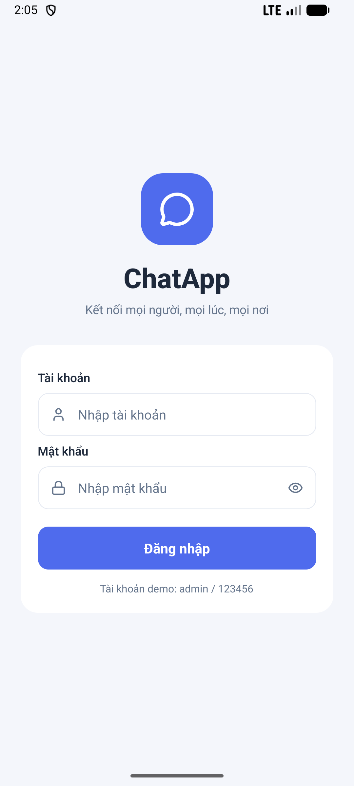
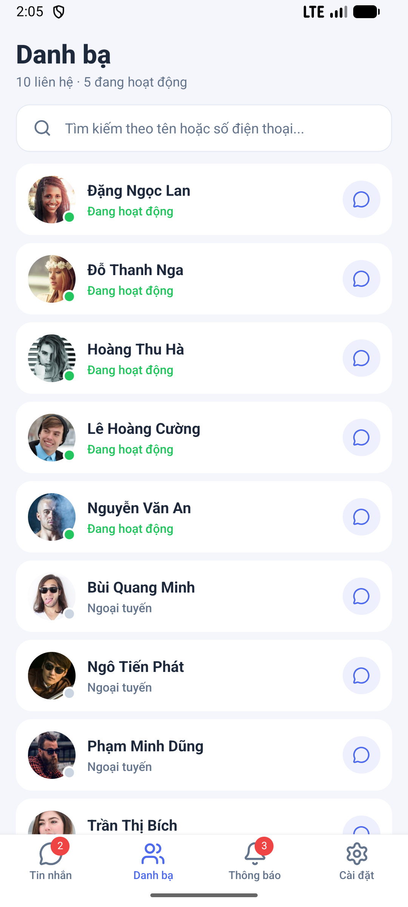
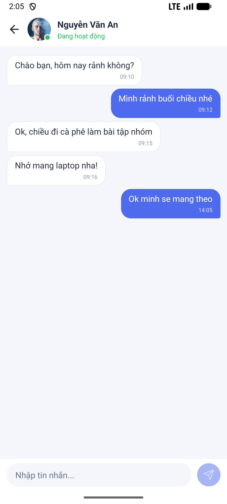
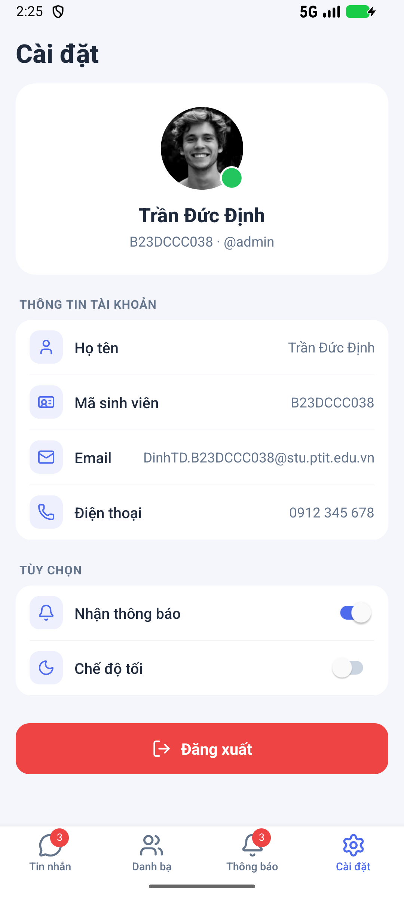

# Bài thực hành 2 – Ứng dụng Chat (React Native)

Sinh viên: **Trần Đức Định** – MSSV: **B23DCCC038**

## File APK
File cài đặt: [`ChatApp-B23DCCC038.apk`](ChatApp-B23DCCC038.apk) (~69 MB, bản release, đã đóng gói sẵn JS nên **không cần Metro**).

Cách cài:
- **Điện thoại Android:** chép file APK vào máy, mở file và cho phép cài từ nguồn không xác định.
- **Máy ảo:** kéo thả file APK vào cửa sổ máy ảo, hoặc chạy:
  ```bash
  adb install -r ChatApp-B23DCCC038.apk
  ```

Build lại APK (sau khi sửa code):
```bash
cd android && ./gradlew assembleRelease
# file tạo ra: android/app/build/outputs/apk/release/app-release.apk
```

> APK được ký bằng debug keystore mặc định của template – dùng để cài thử/nộp bài, không dùng để đưa lên Google Play.

## Ảnh chụp màn hình
Thư mục [`screenshots/`](screenshots/) chứa ảnh chụp giao diện trên máy ảo Android (1080×2400):

| File | Màn hình |
|---|---|
| `0-login.png` | Đăng nhập |
| `1-home.png` | Home – danh sách cuộc trò chuyện |
| `2-chat.png` | Nội dung chat (sau khi gửi một tin nhắn) |
| `3-contacts.png` | Danh bạ |
| `4-notifications.png` | Thông báo |
| `5-settings.png` | Cài đặt – thông tin tài khoản |

<p>
  
  
  
  
  
  
</p>

## Chạy từ mã nguồn
```bash
npm install
npm start            # terminal 1: Metro
npm run android      # terminal 2: build & cài lên máy ảo/thiết bị
```

Tài khoản demo: **admin / 123456**

## Các màn hình
| Màn hình | File | Chức năng |
|---|---|---|
| Đăng nhập | `src/screens/LoginScreen.tsx` | Kiểm tra rỗng, sai tài khoản/mật khẩu, ẩn/hiện mật khẩu |
| Home (Tin nhắn) | `src/screens/HomeScreen.tsx` | Danh sách hội thoại, số tin chưa đọc, tìm kiếm (không dấu) |
| Chat | `src/screens/ChatScreen.tsx` | Xem & gửi tin nhắn, tự đánh dấu đã đọc |
| Danh bạ | `src/screens/ContactsScreen.tsx` | Trạng thái online, tìm theo tên/SĐT, mở hội thoại |
| Thông báo | `src/screens/NotificationsScreen.tsx` | Lọc, phân biệt đã đọc/chưa đọc, đánh dấu đã đọc (từng cái / tất cả) |
| Cài đặt | `src/screens/SettingsScreen.tsx` | Thông tin tài khoản, Switch thông báo & chế độ tối, đăng xuất |

## Cấu trúc
```
src/
  commons/      dữ liệu mẫu, theme (sáng/tối), tiện ích
  contexts/     AppContext – trạng thái đăng nhập, hội thoại, thông báo
  navigation/   Stack (Login / Main / Chat) + Bottom Tabs
  components/   Avatar, SearchBar, ScreenHeader, ConversationItem, ...
  screens/      các màn hình
screenshots/    ảnh chụp giao diện 6 màn hình
ChatApp-B23DCCC038.apk   file cài đặt Android
```
